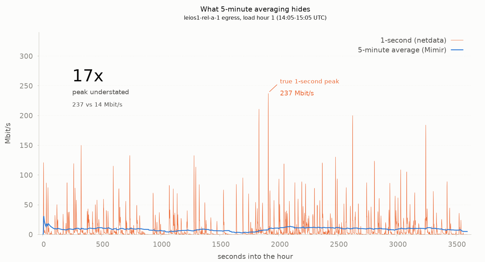
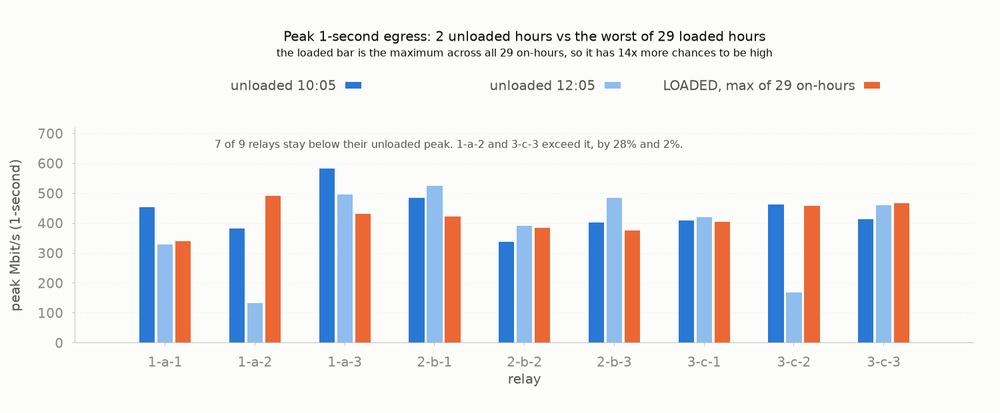
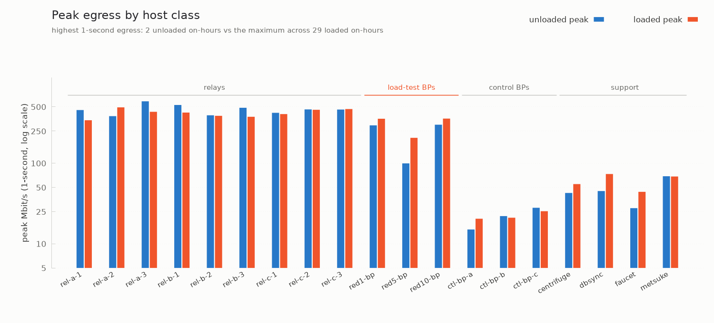

# Leios vote load test — results

**Date:** 2026-10-09. All times UTC.
**Coverage:** continuous load from 2026-10-09 14:02 to 2026-10-12 00:00 UTC. Mimir metrics
across 29 loaded on-hours against unloaded baselines back to 2026-10-07, plus 1-second
netdata for 19 hosts: six 1-hour windows on 10-09 and 58 continuous hours to 10-12 00:00.

**Units and conventions.** All bandwidth is **Mbit/s**, including figures Mimir reports in
MiB/s, which are converted at 8.389. Every *mean* is a 1-hour mean and is independent of the
instrument's averaging window; every *peak* is not, so peaks always state whether they are
5-minute-averaged or 1-second. Where a figure pools more than one hour, the number of hours
is given.

## What was tested

750 synthetic pools (`lt001`–`lt750`) were registered against the leios network and their
BLS keys merged into 76-key arrays on the ten `leiosred*-bp-*` block producers. The chain
sits at 900 live pools, exactly the CIP-0164 committee cap. The synthetic seats hold
negligible stake, so they add vote *volume* without adding vote *weight*.

Keys were deployed at ~14:02. The three `leios[1-3]-bp-*` hosts kept a single real key each
and are the control group, the most useful instrument in the test.

**Only those three** have a topology fixed by configuration rather than by chance:
cardano-parts sets `useLedgerAfterSlot = -1` and `bootstrapPeers = null` for the `bp` role
and takes producers from the filtered intra-cluster list as trustable localRoots, so no
ledger peers, no peer sharing, and 4 hot peers as a configured constant rather than an
emergent value. The ten `leiosred*-bp-*` hosts are **not** like this — `leiosRedTeamBp`
imports `leiosBp` but then forces `services.cardano-node-topology.role` to `edge` — so they
use ledger peers and peer sharing, and their connection counts drift as the relays' do.

The controls are not restart-free either. Every leios host carries `RuntimeMaxSec = 12 *
3600` (`flake/colmena.nix`) to cap a node memory leak before it reaches OOM, so all 19 hosts
restart on a staggered 12-hour timer throughout. See Methodology for what that does and does
not explain.

### The underlying transaction load

Two distinct loads are in play and it matters which one is which. **The vote load is what
this test changed** — 750 extra committee seats casting votes. **The transaction load is the
pre-existing background** that drives block and EB production, and it was *not* raised for
this test. It is described here because it sets the duty cycle that every comparison in this
document is phase-aligned to.

Transactions come from `tx-centrifuge` on `leios1-centrifuge-a-1`, configured to submit to
one relay in each group — `leios1-rel-a-1`, `leios2-rel-b-1` and `leios3-rel-c-1` on port
3001, the node-to-node port. Its `rate_limit.params.tps` is 100, but that is a ceiling
rather than a target: the achieved rate ran **32.7–46.4 tx/s** across the nine 10-09
windows.

A **second generator runs alongside it**: `tx-firehose` on `leios2-rel-b-2` (the
`leiosFirehose` import in `flake/colmena.nix`), on the same even-hour cadence —
`cardano-tx-firehose.timer` is also `OnCalendar=00/2:00:00`, with its own stop timer and the
same 4200s backstop. Both generators are therefore submitting during exactly the same hours.

The two are cleanly separable on chain by their transaction metadata, and db-sync over the
58-hour window gives the split:

| generator | tx size | metadata | on chain | count | by count | by bytes |
|---|---|---|---|---|---|---|
| `tx-centrifuge` | 506 bytes | key `0`, 256-byte payload | 267 bytes | 3,335,846 | 73.9% | 85.3% |
| `tx-firehose` | 247 bytes | key `1022`, colour tag `0x532bee` | 8 bytes | 1,176,195 | 26.1% | 14.7% |

Centrifuge's 256-byte payload reaches 267 bytes on chain once CBOR framing is counted. The
firehose tags each transaction with a 3-byte run colour instead, which is why its
transactions are less than half the size.

Because the two sizes differ by more than 2×, **count and bytes tell different stories**:
the firehose is a quarter of the transactions but under a sixth of the bytes, 290.5 MB
against centrifuge's 1,687.9 MB over the 58 hours. Which denominator is the right one
depends on the question, and anything downstream of EB size wants bytes. A single mean
transaction size across both — 438 bytes — describes neither generator.

Both shapes appear in off-hours too, at roughly 7% of on-hour volume, which is the mempool
draining rather than a third source. Separately, 1,055 transactions in the window carry no
metadata at all, 1,020 of them a uniform 202 bytes confined to 16:54–20:05 on 10-09; they
are 0.023% of the total and are not attributed here.

**The duty cycle is one hour on, one hour off**, driven by a pair of systemd timers:
`cardano-tx-centrifuge.timer` fires `OnCalendar=00/2:00:00`, so the generator starts on
even hours at `:00`, and a separate stop timer halts it on odd hours. `RuntimeMaxSec=4200`
on the service is a backstop should the stop timer not fire, not the mechanism.

Averaged over the whole weekend, fleet relay egress by minute of the two-hour cycle shows
the shape clearly:

| phase | minutes into cycle | fleet egress |
|---|---|---|
| generator ramp | 0–4 | 90.2 Mbit/s |
| steady on | 5–59 | 103.8 |
| post-stop decay | 60–64 | 58.2 |
| off | 65–119 | 16.5 |

Steady-on carries **6.3×** the off-hour level. Two consequences follow. First, an on-hour
and an off-hour are not comparable at all, so every before/after offset in this document is
an even number of hours. Second, the generator does not stop cleanly: traffic takes about
four minutes to drain after the stop timer fires, as in-flight transactions, EBs and votes
finish propagating.

The analysis windows are anchored at `:05` rather than `:00`, so each one skips the ramp and
instead includes those four minutes of decay at its end — roughly 55 minutes of steady load
plus a short tail. Every window in the test uses the same convention, loaded and unloaded
alike, so comparisons between them remain like-for-like.

Note that the transaction rate was **lower** during the loaded windows (32.7–39.7 tx/s) than
during the unloaded baselines (42.3–46.4 tx/s). It is tracked as a confounder in the tables
below: any measure that rises under load does so despite slightly *less* transaction
traffic, not because of more.

**Node build: Leios prototype w40a.** The nine relays run the governor-patched variant
(`node-leios-patched`); every other host runs plain `node-leios`. Every number in this
document is specific to that build. w40a carries a known network incompatibility with
earlier prototypes (`leiosNotifyPipelineDepth` raised 100 → 1000), so results here should
not be compared against measurements taken on w39 or earlier. Nothing here distinguishes
behaviour specific to w40a from behaviour intrinsic to Leios, so treat every finding as
scoped to this build until it is reproduced on another.

## Headline

The load ran continuously from 2026-10-09 14:02 through 2026-10-12 00:00, covering 29 loaded
on-hours. How much "vote volume" rose depends on what is counted, and the four answers differ
by an order of magnitude:

| measure | unloaded | loaded | ratio |
|---|---|---|---|
| committee seats, from the maximum `voterId` observed | ~142 | 900 | **6.3×** |
| seats actually casting votes | 90 | 788+ | **8.8×** |
| vote records diffusing, per node | 1.91/s | 28.63/s | **15×** |
| our own fleet's cast rate | 24.5/min | 1654/min | **67×** |

The headline figure for the network is **15×**, the rate at which each node actually has to
receive and process votes. The 67× is our fleet's own casting rate, large only because our
block producers went from **13 voting keys to 763** — three control hosts at one key each
plus ten `leiosred` hosts at 76 — moving us from roughly 14% of all active voters to the
large majority of them. It is a statement about our share of the committee, not about
network load.

Those key counts are the physical ones. Mimir's `count by (instance, voterId)` reads 15 and
765 because `leiosred2-bp-b-1` and `leiosred6-bp-f-1` each carry series for both `voterId`
12 and 13, with only one incrementing on each host: two stale zero-rate series,
cross-contaminated between the pair. Series counts include series that have stopped
incrementing, so they are not a key count.

**Three measured costs:**

- **Node CPU**, relay mean in cores: unloaded 0.313–0.400, loaded 0.50–0.64 across sampled
  weekend on-hours. Every sampled hour clears the unloaded band.
- **EB announcement late fraction:** unloaded 0.00–1.33%, loaded 2.8–6.1%, sustained for
  58 hours.
- **Certification rate is down.** Certified EBs per forged EB: 31.9% loaded (253 of 794)
  against 38.1% unloaded (261 of 685), z ≈ 2.51, **p ≈ 0.012**.

**Relay bandwidth shows no vote-attributable effect.** Comparing each statistic against its
own kind across the 29 loaded on-hours: hourly means run 73.9–136.5 Mbit/s against unloaded
means of 86.8 and 118.0, and 1-second fleet peaks run 1304–2048 Mbit/s against unloaded
peaks of 1776 and 2278. **The largest burst anywhere in the test, 2278 Mbit/s, falls in an
unloaded hour** — despite the loaded set having 29 hours in which to beat it against the
baseline's 2.

**Mean vote tally cannot be used** to corroborate anything here: its denominator is vote
arrivals, which rose ~15×, so the metric moves mechanically under this load.

## The 10-09 window comparison

Five of the nine 10-09 windows, phase-aligned to the duty cycle, each exactly 1h: the two
unloaded baselines and the first three loaded hours. `load4` is omitted because the Mimir
collection stops at `load3`; the 1-second sections below do cover it. The load then
continued for a further 51 hours, and those figures appear in later sections.

Each window is labelled by the hour it ends: `base_11` is 10:05-11:05, `base_13` is
12:05-13:05, and `load1` through `load3` are 14:05-15:05, 16:05-17:05 and 18:05-19:05.

**Vote volume**

| metric | base_11 | base_13 | load1 | load2 | load3 |
|---|---|---|---|---|---|
| votes cast /min (fleet) | 24.450 | 24.450 | 1654.105 | 1509.042 | 1426.367 |
| votes acquired /s (per-host avg) | 1.695 | 1.907 | 28.631 | 25.938 | 24.130 |
| txgen submitted /s (confounder) | 46.434 | 42.337 | 32.727 | 35.211 | 39.734 |

**Relay bandwidth, Mbit/s**

| metric | base_11 | base_13 | load1 | load2 | load3 |
|---|---|---|---|---|---|
| relay egress total | 118.5 | 88.5 | 90.2 | 80.0 | 95.8 |
| relay egress peak-host | 71.1 | 31.6 | 28.0 | 28.2 | 22.4 |
| relay ingress total | 26.0 | 20.5 | 25.9 | 25.3 | 28.5 |
| relay ingress peak-host | 5.3 | 5.8 | 6.3 | 7.3 | 7.0 |

**Block-producer bandwidth, Mbit/s**

| metric | base_11 | base_13 | load1 | load2 | load3 |
|---|---|---|---|---|---|
| leiosred BP egress total | 66.4 | 59.8 | 41.5 | 73.0 | 86.9 |
| leiosred BP egress peak | 18.2 | 19.3 | 10.1 | 18.1 | 22.0 |
| control BP egress total | 1.8 | 1.7 | 2.0 | 2.0 | 2.1 |
| control BP egress peak | 1.0 | 1.1 | 1.2 | 1.2 | 1.3 |

**Cost**

| metric | base_11 | base_13 | load1 | load2 | load3 |
|---|---|---|---|---|---|
| relay CPU mean cores | 0.397 | 0.315 | 0.525 | 0.488 | 0.550 |
| relay CPU peak-host cores | 0.927 | 0.707 | 1.047 | 0.946 | 1.097 |
| votes declined /s (fleet) | 0.045 | 0.035 | 0.089 | 0.090 | 0.128 |
| EB announce late /s (fleet) | 0.003 | 0.008 | 0.014 | 0.040 | 0.047 |

**Chain and transport**

| metric | base_11 | base_13 | load1 | load2 | load3 |
|---|---|---|---|---|---|
| EBs certified /h (bp-a-1) | 9.000 | 7.000 | 5.000 | 6.000 | 4.000 |
| EBs forged /h (bp-a-1) | 20.000 | 20.000 | 19.000 | 21.000 | 25.000 |
| relay MuxErrored remote /h | 1227.000 | 1171.000 | 1482.000 | 1233.000 | 2977.000 |
| relay MuxErrored loopback /h | 492.000 | 495.000 | 525.000 | 503.000 | 478.000 |
| relay ExceededTimeLimit /h | 473.000 | 470.000 | 869.000 | 601.000 | 569.000 |

## Bandwidth verdict — relays

Classification legend:

- **Real signal** — loaded values fall outside the full unloaded range, consistent
  direction, no sufficient confounder.
- **Within noise** — load values fall inside the spread of unloaded baselines.
- **Confounded** — moved, but a non-vote cause is present and sufficient.
- **Invalid comparator** — the metric's denominator changed meaning under load; it cannot
  be compared before/after at all.
- **Null result (expected)** — predicted not to move, and did not.

Unloaded figures are the two 1-second baseline hours; Mimir-derived ranges elsewhere use
five phase-aligned baseline on-hours.

| Measure | Unloaded | Loaded (29 on-hours) | Verdict |
|---|---|---|---|
| Fleet egress mean, Mbit/s | 86.8, 118.0 (2 hourly means) | 73.9–136.5 (range of 29 hourly means) | **Within noise** |
| Fleet egress 1s peak, Mbit/s | 1776, 2278 (2 hours) | 1304–2048 over 29 hours, none above 2278 | **Within noise** |
| Fleet ingress mean, Mbit/s | 19.8, 25.1 | 24.9–30.0 over the 10-09 load hours | **Within noise** |
| NIC drops, packets/s | 0 | 0 | **Null result** |

Across 29 loaded on-hours the fleet egress mean spans 73.9–136.5 Mbit/s, bracketing the two
unloaded means of 86.8 and 118.0; six loaded hours sit above the higher unloaded figure and
nine sit below the lower one. No loaded hour reaches the highest unloaded 1-second peak.
With 29 loaded hours against 2 unloaded, the unloaded sample is the limiting one, but the
loaded distribution straddles it rather than sitting above it.

### The duty cycle splits the weekend cleanly

The transaction generator alternates on and off by the hour. Off-hours carry no votes, so
comparing off-hours isolates non-vote causes. Fleet relay egress across the loaded weekend,
split by whether the external peer described in the mux-error section was active:

Unlike the per-hour figures elsewhere, these **pool every second in the period into a single
mean**, so each cell covers many hours rather than one:

| period | on-hours mean | n hours | off-hours mean | n hours |
|---|---|---|---|---|
| peer active (Fri 20:00 – Sat 11:30) | 96.8 Mbit/s | 11 | 15.3 Mbit/s | 10.5 |
| peer free (Sat 11:30 – Mon 00:00) | 102.0 Mbit/s | 18 | 26.8 Mbit/s | 18.5 |

Egress is **higher** without the peer on both axes, so the peer does not drive relay
bandwidth. Off-hour egress is in any case extremely variable, spanning 5.7–69.8 Mbit/s
across the 28 off-hours regardless of peer presence, so any two-window comparison of
off-hours is uninformative.

Relay egress tracks peer degree and block serving rather than vote volume: the relays that
swing hardest between any two windows are the ones whose duplex connection counts moved,
and relay connection counts vary by up to 40% between windows. That link is inferred from
correlation on the relays, which do use peer sharing and ledger peers.

The control BPs are the experiment that does hold topology fixed while vote load varies:
their peer set is pinned by configuration at 4 hot peers, and their egress stayed flat
across every window.

### The control group

The three control BPs have config-pinned topology and one key each. They restart on the same
12-hour timer as every other host, so stability here is not an artefact of leaving them
alone. Across the four 10-09 windows their peak **5-minute-averaged** egress is, in
**Mbit/s**:

| Host | base_11 | base_13 | load1 | load2 |
|---|---|---|---|---|
| `leios1-bp-a-1` | 1.01 | 1.03 | 0.97 | 1.14 |
| `leios2-bp-b-1` | 0.92 | 0.92 | 0.84 | 0.91 |
| `leios3-bp-c-1` | 0.96 | 1.12 | 1.21 | 1.16 |

Flat to within 20% across twelve measurements. Meanwhile the loaded BPs, carrying 76 keys
each against the control's one, range from 2.5 to 19.3 Mbit/s *in the unloaded hours alone*.
Their variance has nothing to do with votes.

## Absolute egress

Load hour 1 only, loopback excluded. These are 5-minute averaged rates, so "peak" means a
sustained five-minute peak, not an instantaneous burst. Note load1 is the hour containing
the ten key-deploy restarts, so it is the least representative of the 29 loaded hours.

| Group | mean Mbit/s | 5-min peak Mbit/s |
|---|---|---|
| Busiest relay (`leios2-rel-b-2`, 118 conns) | 13.9 | 28.0 |
| Highest-degree relay (`leios3-rel-c-1`, 141 conns) | 13.4 | 22.7 |
| All 9 relays, range | 7.1–13.9 | 10.5–28.0 |
| Relay fleet total | 90.2 | — |
| leiosred BPs (loaded), each | 2.8–6.3 | 4.8–10.1 |
| Control BPs, each | 0.59–0.75 | 0.84–1.17 |

Nothing here exceeds **28 Mbit/s as a 5-minute average**, which is what this table measures.
That is not a statement about instantaneous load: the 1-second section below records
per-relay peaks of 125–585 Mbit/s and fleet peaks to 2278 Mbit/s in the same environment.
The highest 5-minute relay peak across the 10-09 windows was 71.1 Mbit/s, in an *unloaded*
hour.

The highest-degree relay is not the worst hit. `leios3-rel-c-1` at 141 connections carries
the same ingress as `leios1-rel-a-1` at 106. Vote load scales with vote rate, not peer
count, at this scale.

## Per-relay peak egress — 5-minute view

**Units: Mbit/s**, converted from the MiB/s that Mimir reports. These are `rate5m`
recording rules, so each value is the highest *five-minute average* in the window, not
an instantaneous peak. The 1-second section below measures the same thing at full
resolution: `leios1-rel-a-1` in `base_11` reads 20.2 Mbit/s here against a true
1-second peak of 456 Mbit/s in that same hour.

```
peak 5-minute-averaged egress, Mbit/s
relay                 base_11      base_13        load1        load2
leios1-rel-a-1           20.2         17.6         14.0         18.8
leios1-rel-a-2           29.9          6.8         16.4         16.3
leios1-rel-a-3           71.1         20.5         10.5         18.9
leios2-rel-b-1           23.1         21.0         16.7         13.5
leios2-rel-b-2           19.5         21.1         28.0          9.7
leios2-rel-b-3           23.6         17.7         17.9         15.6
leios3-rel-c-1           18.0         31.6         22.7          8.7
leios3-rel-c-2           16.6          7.0         14.8         28.2
leios3-rel-c-3           22.3         19.7         18.0         25.8
```

Every relay swings by 2–10× across the *baseline* hours. No column is distinguishable from
any other. Even at this coarse resolution, relay egress carries no vote signal.

## 1-second resolution — the measurement that matters for peaks

Every figure above comes from Mimir's `rate5m` recording rules: a 5-minute average taken
from a 60-second scrape. That is exact for means and totals, but it flattens peaks badly.
Each host also runs **netdata at `update_every=1s`** (enabled fleet-wide by cardano-parts
`profile-basic.nix` as a local standby collector, deliberately not scraped by alloy), which
holds true per-second data for 8d22h to 21d8h depending on the host, measured 2026-10-12.

Nineteen hosts — all 9 relays, 3 loaded BPs, 3 control BPs, db-sync, centrifuge, faucet and
metsuke — were pulled at 1-second resolution: six 1-hour windows on 10-09 plus 58
continuous hours to 10-12 00:00. Charts are in `charts/`. Units below are **Mbit/s**,
netdata's native unit for these charts.



### Fleet total egress, summed across the 9 relays each second

```
all values Mbit/s; pk/mean is a ratio
window         mean       p50       p95       p99       max   pk/mean
base_11       118.0      31.1     637.3    1253.5    2277.7      19.3
base_13        86.8      19.9     447.0    1100.3    1776.4      20.5
load1          89.4      30.4     402.8     805.9    1303.7      14.6
load2          80.2      24.2     359.1     758.7    1447.7      18.1
load3          93.5      29.8     445.0     871.4    1396.4      14.9
load4         136.5      64.4     540.1    1062.6    1724.2      12.6
```

Every statistic here is computed on the fleet series itself — the 3600 per-second sums — not
by combining per-host statistics. Only the mean is the same either way; a sum of per-host
maxima would be 3419 Mbit/s for `base_13` against the true 1776, because the relays do not
peak in the same second.

**Fri 20:05 is the busiest of the six 10-09 windows at 136.5 Mbit/s mean, but it is not an
outlier.** Across the 29 loaded on-hours through 10-12 the fleet egress mean spans
73.9–136.5 Mbit/s, so that hour is simply the top of the range: six loaded hours exceed the
higher unloaded mean of 118.0 and nine fall below the lower one of 86.8. Its 1-second peak
of 1724 Mbit/s sits between the two unloaded peaks of 1776 and 2278, and no loaded hour
anywhere in the 58 hours reaches the 2278 maximum.

### Fleet total ingress

```
all values Mbit/s; pk/mean is a ratio
window         mean       p95       p99       max   pk/mean
base_11        25.1     115.5     234.1     398.7      15.9
base_13        19.8      95.8     226.7     466.4      23.5
load1          25.6     102.9     178.8     320.5      12.5
load2          24.9     103.2     212.5     544.6      21.9
load3          27.7     109.1     218.1     462.1      16.7
load4          30.0     113.9     227.6     419.3      14.0
```

### Per-relay egress: mean / p99 / max, Mbit/s

Mean of the 1-second samples, p99 and max, split by statistic so each table stays readable.

**Mean**, Mbit/s

| relay | base_11 | base_13 | load1 | load2 | load3 | load4 |
|---|---|---|---|---|---|---|
| `leios1-rel-a-1` | 12.9 | 6.3 | 8.7 | 10.3 | 10.7 | 30.5 |
| `leios1-rel-a-2` | 14.3 | 3.9 | 10.5 | 10.9 | 12.2 | 15.0 |
| `leios1-rel-a-3` | 19.7 | 10.7 | 7.3 | 9.7 | 11.4 | 14.7 |
| `leios2-rel-b-1` | 11.2 | 12.2 | 8.0 | 8.4 | 10.0 | 11.0 |
| `leios2-rel-b-2` | 11.2 | 10.4 | 13.6 | 6.5 | 10.2 | 12.0 |
| `leios2-rel-b-3` | 11.5 | 11.3 | 7.1 | 10.3 | 10.3 | 16.0 |
| `leios3-rel-c-1` | 11.1 | 18.4 | 13.4 | 5.5 | 9.2 | 10.0 |
| `leios3-rel-c-2` | 10.5 | 2.8 | 9.0 | 11.6 | 10.7 | 13.0 |
| `leios3-rel-c-3` | 15.5 | 10.7 | 11.8 | 7.0 | 8.8 | 14.3 |

**p99**, Mbit/s

| relay | base_11 | base_13 | load1 | load2 | load3 | load4 |
|---|---|---|---|---|---|---|
| `leios1-rel-a-1` | 170 | 98 | 89 | 109 | 101 | 123 |
| `leios1-rel-a-2` | 149 | 41 | 118 | 124 | 125 | 143 |
| `leios1-rel-a-3` | 218 | 160 | 74 | 113 | 127 | 152 |
| `leios2-rel-b-1` | 152 | 187 | 84 | 94 | 99 | 117 |
| `leios2-rel-b-2` | 169 | 172 | 116 | 65 | 109 | 128 |
| `leios2-rel-b-3` | 174 | 188 | 68 | 109 | 121 | 168 |
| `leios3-rel-c-1` | 161 | 173 | 136 | 56 | 90 | 115 |
| `leios3-rel-c-2` | 162 | 35 | 88 | 107 | 118 | 151 |
| `leios3-rel-c-3` | 143 | 161 | 113 | 57 | 86 | 108 |

**Max**, Mbit/s

| relay | base_11 | base_13 | load1 | load2 | load3 | load4 |
|---|---|---|---|---|---|---|
| `leios1-rel-a-1` | 456 | 330 | 237 | 228 | 287 | 265 |
| `leios1-rel-a-2` | 383 | 135 | 228 | 290 | 276 | 370 |
| `leios1-rel-a-3` | 585 | 497 | 175 | 312 | 274 | 433 |
| `leios2-rel-b-1` | 486 | 527 | 298 | 219 | 268 | 339 |
| `leios2-rel-b-2` | 339 | 392 | 270 | 128 | 247 | 289 |
| `leios2-rel-b-3` | 405 | 486 | 125 | 338 | 334 | 336 |
| `leios3-rel-c-1` | 410 | 421 | 371 | 134 | 238 | 249 |
| `leios3-rel-c-2` | 464 | 170 | 223 | 263 | 291 | 366 |
| `leios3-rel-c-3` | 414 | 462 | 313 | 170 | 215 | 249 |



### What this changes

**The traffic is extremely bursty.** Median per-relay egress is 2–32 Mbit/s while 1-second
peaks reach 585 Mbit/s. Fleet peak-to-mean ratios run 11–23×. The link is near-idle most of
the time and spikes roughly 100× for brief moments.

**Means are unaffected; only peaks are.** A mean is independent of the averaging window,
since both instruments are computing bytes-per-hour over the same hour. Mimir's mean of
5-minute averages and netdata's mean of 1-second samples agree to within 0.4–2.9% on all six
10-09 windows. So every "mean" in this document is a 1-hour mean whichever tool produced it,
and the discrepancy below applies to peaks alone.

**The 5-minute metric understates peaks by 15–25×.** Mimir reported `leios1-rel-a-1`'s
load1 peak egress as 14.0 Mbit/s. The true 1-second peak that hour was
**237 Mbit/s**. Fleet-wide, momentary egress reaches **1.0–2.3 Gbit/s** against a
5-minute-averaged fleet total of 80–120 Mbit/s.

Every "sustained" figure in this document therefore describes a 5-minute average and says
nothing about instantaneous load. Peaks are an order of magnitude higher, and 585 Mbit/s on
a single relay is over half a 1 Gbps link.

**The load conclusion holds at this resolution and is strengthened by it:**

- The largest single-relay peak anywhere in the dataset, 585 Mbit/s, is in `base_11` — an
  *unloaded* hour.
- Fleet peak egress is highest in an unloaded hour, 2278 Mbit/s against 1776 for the other
  baseline hour. Across all **29** loaded on-hours through 10-12 the peak range is
  1304–2048, so **none reaches the unloaded maximum**, even with 29 chances against 2.
- Per relay, taking the maximum across all 29 loaded hours against the maximum across the
  two unloaded hours, **7 of 9 relays stay below their unloaded peak**. Two exceed it:
  `leios1-rel-a-2` at 492 against 383 Mbit/s, and `leios3-rel-c-3` at 469 against 462.

That last point needs care rather than rounding off. The comparison is the maximum of 29
draws against the maximum of 2, so the loaded side has far more chances to produce a high
value even if the underlying distributions are identical. Two relays edging past by 2% and
28% is what that asymmetry alone would produce; it is not evidence of a load effect, but
neither can the per-relay comparison be stated as a clean sweep.

The fleet-level comparison does not suffer the same problem as badly, because fleet peaks
aggregate nine relays per sample, and there **none of the 29 loaded hours reaches the
unloaded maximum**. Measuring at the resolution where bursts actually live, the unloaded
hours still bound the loaded ones.

**Headroom, honestly stated.** Sustained utilisation is trivial, but peaks of 300–585
Mbit/s per relay are a real fraction of a gigabit link, and that was true before the vote
load. `node_network_*_drop_total` is a counter rather than an average, so it catches loss at
any timescale, and it is zero across every window. Nothing is being dropped — but the
headroom is smaller than the averaged metrics imply.

### By host class



The chart separates the classes cleanly. Relays end up at or below their unloaded peak on
seven of nine hosts. The three **load-test BPs are the only class that rises** — 294→355,
99→206 and 300→357 Mbit/s — which is what should happen, since they are the hosts actually
casting the extra votes. The control BPs and the support hosts do not move.

The table below is the complementary view: per-host 1-second egress in **Mbit/s**, as the
range each class spans across the six 10-09 windows. Mean is the hourly mean; p99 and max
are of the 1-second samples.

| class | hosts | mean Mbit/s | p99 Mbit/s | max Mbit/s |
|---|---|---|---|---|
| relay | 9 | 2.8–19.7 | 35–218 | 125–585 |
| BP, loaded (76 keys) | 3 | 1.4–12.0 | 14–151 | 41–300 |
| **BP, control (1 key)** | 3 | **0.5–0.7** | **6–8** | **13–28** |
| db-sync | 1 | 0.7–1.9 | 6–17 | 22–45 |
| centrifuge | 1 | 2.2–2.6 | 19–26 | 32–43 |
| faucet | 1 | 1.1–1.9 | 8–18 | 17–28 |
| metsuke | 1 | 1.5–2.6 | 8–27 | 16–69 |

The control BPs are the sharpest result in the whole test. Across six windows and three
hosts — eighteen measurements spanning unloaded and loaded hours — their mean egress stays
within 0.5–0.7 Mbit/s and their peak within 13–28. Flat to within a factor of two on peaks
that elsewhere swing by a factor of ten.

They differ from the loaded BPs in two respects at once, not one: 1 BLS key instead of 76,
and 4 hot peers instead of 20. So the *level* difference between the groups — control BPs
under 28 Mbit/s, loaded BPs reaching 41–300 — cannot be attributed to key count from this
comparison alone; peer count is a sufficient alternative explanation and the two are
confounded between groups.

What the control group does establish is the **within-group** result, and that is the one
that matters. Their peer set is pinned by configuration, so it is constant across unloaded
and loaded hours while vote load varies by the full amount. Egress does not move. That is a
controlled before/after on the only variable that changed for them, and it is why these
three hosts carry more weight than any relay comparison in this document.

## What did move

The first nine windows, five unloaded and four loaded, all on 2026-10-09. The load then ran
continuously for a further 51 hours; weekend figures are given per measure below.

| metric | base_05 | base_07 | base_09 | base_11 | base_13 | load1 | load2 | load3 | load4 |
|---|---|---|---|---|---|---|---|---|---|
| EB announce late % | 0.000 | 1.331 | 0.286 | 0.345 | 1.132 | 1.324 | 3.859 | 4.049 | 3.322 |
| relay CPU mean cores | 0.313 | 0.358 | 0.400 | 0.397 | 0.315 | 0.525 | 0.488 | 0.546 | 0.609 |
| relay egress total Mbit/s | 80.8 | 100.9 | 118.8 | 118.5 | 88.5 | 90.2 | 80.0 | 95.8 | 140.6 |
| remote mux errors /h | 1107 | 1166 | 1199 | 1227 | 1171 | 1482 | 1233 | 2977 | 3542 |
| loopback mux errors /h | 526 | 485 | 506 | 492 | 495 | 525 | 503 | 478 | 491 |
| certified / forged EB | 46.7% | 37.0% | 33.3% | 45.0% | 35.0% | 26.3% | 28.6% | 16.0% | 36.4% |
| declines per 1000 votes | 137.1 | 134.3 | 162.7 | 106.3 | 87.1 | 3.0 | 3.4 | 5.6 | 4.7 |
| votes cast /min | 25.6 | 27.0 | 28.3 | 24.5 | 24.5 | 1654.1 | 1509.0 | 1426.4 | 1508.6 |
| txgen submitted /s | 46.2 | 44.0 | 46.4 | 46.4 | 42.3 | 32.7 | 35.2 | 39.7 | 38.0 |

Relay egress is the only bandwidth row here; it is the Mimir 5-minute-averaged
hourly mean, so it is a mean and not comparable to the 1-second peaks quoted elsewhere.

Sampled weekend on-hours, through 10-12 00:00:

```
on-hour       CPU cores   EB late %   decl/1k
Fri 20:05        0.6080       3.322     4.728
Sat 02:05        0.4979       2.995     5.040
Sat 08:05        0.5369       3.200     5.681
Sat 14:05        0.5871       3.510     6.959
Sat 20:05        0.5641       2.808     5.686
Sun 02:05        0.5969       4.259     4.072
Sun 08:05        0.5575       2.950     3.016
Sun 14:05        0.6367       3.000     6.820
Sun 20:05        0.5707       6.078     7.422
```

| Measure | Unloaded | Loaded | Verdict |
|---|---|---|---|
| Relay CPU, mean cores | 0.313–0.400 | 0.50–0.64 | **Real signal** |
| EB announce late, % | 0.00–1.33 | 2.8–6.1 | **Real signal** |
| Certified per forged EB, % | 38.1 pooled | 31.9 pooled | **Real signal**, p ≈ 0.012 |
| Fleet egress mean, Mbit/s | 86.8, 118.0 (2 hourly means) | 73.9–136.5 (range of 29 hourly means) | **Within noise** |
| Remote mux errors, events/h | 1107–1227 | 1154–1479 excluding one peer | **Within noise** |
| Declines per 1000 votes | 87–163 | 3.0–7.4 | **Improved ~25×** |

**CPU is the clearest resource cost.** Every sampled weekend on-hour sits at 0.50–0.64
cores against a 0.313–0.400 unloaded band, with no overlap, sustained across 58 hours.
Absolute values remain modest at roughly 0.6 of a core per relay.

**EB announcement lateness holds and is the signal to watch.** The ratio is
denominator-safe: announcement volume is flat across all windows. It runs 2.8–6.1% against
a 1.33% unloaded maximum, and the highest value is in the last hour sampled, so it is not
obviously settling.

**Declines fell rather than rose.** Per 1000 votes cast, declines run 3.0–7.4 under load
against 87–163 unloaded. The raw per-second rate roughly doubled, but that is volume, not
strain: the voting path sheds proportionally far less work under load.

## What did not move

| Measure | Baseline | Load | Note |
|---|---|---|---|
| Loopback mux errors, events/h | 485–526 | 525, 503, 478, 491 | control series, as expected |
| Declines per 1000 votes cast | 87–163 | 3.0, 3.4, 5.6, 4.7 | improved ~25× |
| Chain density, % of slots with a block | 4.30% | 4.84% | |
| blockNum spread across 26 hosts | — | 2 blocks | no fork or island |
| Hot peers per relay, count | 20 | 20 | |
| Relay `ServerError` events, count | 0 | 0 | listener never dropped |

The decline figure is worth stating carefully. The *raw* decline rate roughly doubled
(0.035–0.045/s to 0.089–0.090/s), which looks like strain until it is normalised against
vote volume. Per 1000 votes cast, declines fell from 87–163 unloaded to 3.0–7.4
under load. The voting path sheds proportionally far less work under load, not more.

The loopback mux series is the useful control: it is the node's own per-minute cli
ping, it should be indifferent to vote load, and it was: 485–526 events/h across the five
baselines, and 478–525 across the four 10-09 load hours. That it held flat is what makes
the remote-series reading trustworthy: the loopback series does not track the external
peer at all, so the two are cleanly separable.

## Certification — reduced under load

### The tally metric cannot be used here

**Mean vote tally is not a valid before/after comparator under this load.** Tally is a
stake-weight fraction in 0–1, compared against a quorum threshold of 0.75. The tally
histogram records one sample per vote arrival, and tally updates rose ~15× with the load.
Each update samples the accumulation curve toward quorum, so denser sampling of the low part
of that curve drags the mean down mechanically. Any reading of mean tally across this step,
in either direction, is an artifact of the denominator.

The tally panel remains a valid *live* view of distance to quorum. Only the before/after
comparison is invalid.

### The denominator-free instrument

Certified EBs per forged EB, counted from `leios1-bp-a-1` logs in 12-hour blocks. Counts are
events per block; the ratio is dimensionless.

| block | certified | forged | ratio | state |
|---|---|---|---|---|
| Tue pm | 51 | 150 | 34.0% | unloaded |
| Wed am | 54 | 142 | 38.0% | unloaded |
| Wed pm | 58 | 137 | 42.3% | unloaded |
| Thu pm | 55 | 144 | 38.2% | unloaded |
| Fri on-hours (5) | 43 | 112 | 38.4% | unloaded |
| Fri load hours (4) | 23 | 87 | 26.4% | **loaded** |
| Fri pm | 39 | 147 | 26.5% | **loaded** |
| Sat am | 46 | 139 | 33.1% | **loaded** |
| Sat pm | 53 | 140 | 37.9% | **loaded** |
| Sun am | 38 | 140 | 27.1% | **loaded** |
| Sun pm | 54 | 141 | 38.3% | **loaded** |

Pooled: **253 certified of 794 forged under load (31.9%)** against **261 of 685 unloaded
(38.1%)**. A two-proportion test gives z ≈ 2.51, **p ≈ 0.012** — a 6.2 point absolute drop.

Forging is unaffected: 137–150 EBs forged per 12-hour block in every state.

### What can and cannot be said

Can be said: the certified fraction is 6.2 points lower under load, the effect clears
p < 0.05 on 794 loaded and 685 unloaded forged EBs, and no loaded 12-hour block reaches the
unloaded mean.

Cannot be said: which mechanism. Loaded blocks span 26.5–38.3% and unloaded 34.0–42.3%, so
the distributions overlap; the separation is in the pooled means, not in every block.

Possible explanations, **none of which this data distinguishes**:

1. **Diffusion strain** — real weighted votes arriving too late to be tallied before the
   EB's window closes. The elevated EB announcement late fraction is consistent with this.
2. **Committee composition** — certification needs a stake-weight fraction of 0.75, and the
   synthetic pools hold negligible stake, so on the face of it they add seats without
   removing weight and should not move the ratio at all. That reasoning holds only if every
   real-stake pool keeps its seat. The chain now sits at exactly the 900-pool CIP-0164 cap,
   leaving no headroom: if seat allocation samples or rotates rather than seating all 900
   each epoch, a real pool that loses its seat takes its stake weight out of the tally with
   it, and 0.75 becomes harder to reach. Whether allocation behaves that way is **not
   established by this test** — it is a question about the selection rule, not about
   capacity.

A post-load recovery period showing the ratio return to the 34–42% band would confirm the
load is the cause rather than a drift over the week. That is the cheapest remaining test.

Chain-level health was otherwise normal throughout: density 4.3→4.8% of slots carrying a
block, blockNum spread of 2 blocks across 26 hosts, hot peers pinned at 20, no
`ServerError`, no fork or island.

## Mux errors — one external peer

A single external address reconnects to the relays continuously from **18:30** onward and
accounts for essentially all elevated mux-error volume.

It is **not a registered pool**: no `pool_relay` row carries that IPv4, and none of the 39
non-fleet DNS-registered relay names resolves to it. Its reverse DNS places it on a
**Starlink** customer connection, so it is a residential or small-business satellite link
rather than a datacentre host. That does not by itself explain the churn; see the cadence
analysis below.

Events per 15 minutes across all 9 relays, that peer against every other peer combined:

```
time    that peer   all others
17:00           2          296
17:30           7          157
18:00           8          159
18:15           2          319
18:30         331          350
19:00         619          246
20:00         656          153
21:00         590          284
22:00         660          170
```

The all-others series is flat across the whole day. Per on-hour, with that address
excluded, in events per 1-hour window across all 9 relays:

| window | all remote | excluding peer | that peer |
|---|---|---|---|
| `base_05` | 1107 | 1107 | 0 |
| `base_07` | 1166 | 1166 | 0 |
| `base_09` | 1199 | 1199 | 0 |
| `base_11` | 1227 | 1227 | 0 |
| `base_13` | 1171 | 1159 | 12 |
| `load1` | 1482 | 1479 | 3 |
| `load2` | 1233 | 1223 | 10 |
| `load3` | 2977 | 1218 | 1759 |
| `load4` | 3542 | 1154 | 2388 |

Excluding the peer, the 10-09 load hours fall inside the 1107–1227 baseline band apart from
`load1` at 1479, the hour containing the ten host restarts. **Mux errors attributable to
the vote load: within noise.**

Two characteristics of the peer's traffic:

- The reason mix is weighted toward `BearerClosed` rather than `recvBuf: resource
  vanished`, consistent with the remote closing connections mid-protocol rather than being
  reset.
- Distinct peer count is unchanged, 27 before and 28 after, so this is one address
  misbehaving rather than broad churn.

### Is it the w40 / w40a incompatibility?

w40a raises `leiosNotifyPipelineDepth` from 100 to 1000. Both sides read their own copy of
the constant, so a w40a initiator pipelines up to 1000 LeiosNotify requests while a w40
responder throws `MkExnLeiosNotifyExcessiveRequests` at 100 and drops the connection.
Connections are duplex, so our w40a relays act as initiator even on peer-dialled links. A
w40 peer would therefore show exactly this shape: connect, run, drop, reconnect.

Several observations fit. The connections are inbound on port 3001 from varying ephemeral
ports, so the peer redials rather than holding one link. The reason is `BearerClosed`,
the remote closing mid-protocol rather than a reset. `MkExnLeiosNotifyExcessiveRequests`
appears **zero** times fleet-wide, which is expected when we are the high-cap side: the
exception is raised and logged by the low-cap peer, not by us.

One observation does not fit, and it is the discriminating one. The overrun is triggered by
LeiosNotify traffic, so churn should scale with Leios activity. It does not:

| window | peer events/h | EBs forged/h | votes/min | announcements/s |
|---|---|---|---|---|
| 19:10–20:05 off | 2584 | 2.2 | 85 | 0.03 |
| 20:05–21:05 **on** | 2388 | 22.0 | 1509 | 1.08 |
| 21:10–22:05 off | 2610 | 2.2 | 67 | 0.02 |

Leios traffic is 10–40× higher in the on-hour while the peer's churn is flat, and marginally
lower in the busy hour. A load-triggered pipelining overrun cannot produce that. The steady
~2500/h rate across all conditions looks timer-driven rather than load-driven.

The mechanism is plausible but the discriminating test does not support it. The reconnect
cadence below narrows it further.

### Reconnect cadence

On a single relay over 30 minutes the peer produced 145 mux errors. Gaps between
consecutive failures are extremely regular:

```
p25 11.4s   median 12.5s   p75 13.5s   p95 14.2s   max 14.4s
142 of 144 gaps fall in the 10-15s bucket; the rest are 5-10s
```

The hard ceiling just under 15s suggests a timer rather than a load-dependent failure.
Two candidates, with what the data says about each:

- **Starlink satellite handovers.** These occur on a globally synchronised 15-second
  schedule, so failures would cluster at fixed offsets in wall-clock time. They do not:
  binning the failure timestamps modulo 15 seconds gives a near-uniform spread, circular
  concentration R = 0.036 where 0 is uniform and 1 is perfectly phase-locked. **Not
  supported.**
- **A per-connection timeout on the peer's side.** A timer that starts when each connection
  is established produces exactly this shape: tight interval, hard ceiling, no alignment to
  absolute time. The reason string is `BearerClosed`, meaning the remote closed the
  connection, which is consistent. **Not confirmed**, but it fits what is observed.

Neither the w40 pipelining mechanism nor satellite handovers explain the pattern. A fixed
timeout on the peer's side does, and the evidence for which timeout would be in its logs.

The peer stopped abruptly at Sat 11:30 and produced exactly zero events thereafter.
Splitting the loaded weekend on that boundary shows fleet egress is slightly *higher*
without it, so the peer does not drive relay bandwidth. See the bandwidth section.

## Vote volume — confirmed working

| Measure | Unloaded | Loaded | |
|---|---|---|---|
| Committee seats, max `voterId` observed | ~142 | 900 | ×6.3 |
| Seats actually casting | 90 distinct | 788+ distinct | ×8.8 |
| Votes acquired, every host | 1.7–1.9 / s | 25.9–28.6 / s | ×15 |
| Fleet voting keys | 13 | 763 | ×58.7 |
| Votes cast, our fleet | 24 / min | 1,426–1,654 / min | ×63–68 |
| Votes cast, per leiosred BP | ~2 / min | 130–250 / min | ×76 |
| Votes cast, per control BP | ~2 / min | ~2 / min | unchanged |

Seat and voter counts come from the `vote.voterId` field in `LeiosVoteAcquired` log bodies
on `leios1-rel-a-1`, which carries the network-wide committee seat index. The unloaded count
is a clean 10-minute sample of 982 records; the loaded count is a 2-minute sample of 1564
records, because a 10-minute loaded window hits Loki's 5000-line cap. **788 is therefore a
floor, not an exact count**, with the true figure somewhere between 788 and 900.

Two things follow that are worth stating separately.

**Before the load, only 90 of ~142 seats actually voted.** The rest held seats silently,
which is what you would expect given BLS key enforcement is CLI-only: a pool can occupy a
committee seat without a key and never cast. The 750 synthetic pools all have keys by
construction, so the active-voter count grew faster than the seat count.

**Active voters rose 8.8× but diffused vote records rose 15×, and this document does not
account for the gap.** A hypothesis that fits is that the synthetic keys vote on every round
while many real pools vote intermittently, so records per active voter rose as well. That is
not tested here.

Votes acquired rose on all 26 hosts including relays, dbsync, faucet, metsuke and
centrifuge, with values tightly bunched, indicating even diffusion.

## Monitoring cost

Alloy absorbed ~15× the vote log lines without stress: CPU ~0.03 cores, RSS flat at
200–300 MiB.

Mimir series for vote metrics went **577 → 2,078**, entirely from
`leios_logmetrics_leios_votes_cast_total` and `leios_logmetrics_leios_voted_weight_total`,
each 15 → 765 series. Both carry a promoted `voterId` label.

That series count is deliberately the raw one and is two higher than the 13 → 763 physical
key count, because two hosts retain a stale series for a seat they do not own. Stale series
are exactly what drives cardinality, so 765 is the right number for a monitoring-cost
argument and the wrong one for counting keys.

`voterId` is a per-host index 1..76, not a pool hash, so it is bounded and safe at this
scale. It is the same stage-label promotion flagged for removal before a larger test; it was
dropped on the acquired side but not on cast or weight.

## Methodology

**The duty cycle is the critical trap.** The transaction generator runs a one-hour on/off
cycle and **votes only exist while it is on** — EBs carry votes only when there are
transactions to endorse. Fleet votes drop to exactly zero during every off hour, under load
as well as at baseline.

Consequences:

1. The load test is only live 50% of wall-clock time.
2. Any before/after comparison must align **on-hour to on-hour**, i.e. an offset that is an
   even number of hours. Comparing an on-hour to an off-hour produces garbage.
3. The load ran continuously from 14:02 on 10-09, giving 29 on-hours through 10-12 00:00.

**One baseline hour is not enough.** The baseline hours vary enough that a single one can be
a 34% outlier on egress, which is sufficient to manufacture a convincing effect out of
nothing. Five phase-aligned baselines were used here; that is the minimum that made the
spread visible. Any claim from this environment that rests on one baseline window should be
treated as unverified.

Known confounders:

- **Every host restarts on a 12-hour staggered timer** (`RuntimeMaxSec = 12 * 3600`), to cap
  a node memory leak before OOM. Restarts arrive in waves across the weekend. They were
  tested as an explanation for the unexplained off-hour egress variance and **do not explain
  it**: Pearson r = −0.047 between relay restarts and fleet egress across the 28 off-hours,
  and the three highest off-hours all had zero relay restarts. They remain a confounder in
  principle, just not a demonstrated one here.
- The ten leiosred BPs additionally restarted at 14:02 for the key deploy, inflating load1's
  connection churn. `load1` is therefore the least representative of the 29 loaded hours and
  is the one hour where mux errors sit above the unloaded band.
- Relay connection counts drift up to 40% between windows, independently of the test. Control
  BP peer counts do not, being config-pinned.
- The 10-09 load hours carried **less transaction throughput** than the baselines (32.7–39.7/s
  against 42.3–46.4/s). This cuts against the CPU and lateness findings, i.e. those effects
  are if anything understated.

Data source: Mimir and Loki via the Grafana datasource proxy. Node-exporter network rates
come from the `instance:node_network_*_bytes_excluding_lo:rate5m` recording rules, which are
5-minute averages over a 60-second scrape — exact for means, 15–25× low on peaks. The
1-second figures come from each host's local netdata instead.

Loki stores each cardano-node log line twice, raw plus alloy-decoded. A line-filter query
such as `{systemd_unit="cardano-node.service"} |= "MuxErrored"` matches both copies and must
be halved; a query selecting on the indexed `kind` label matches one copy and must not be.
Prefer the indexed form: those streams carry ~11.7M lines/hour across the 9 relays, so a
line filter over a multi-hour dashboard range will not complete.

### Why not 1-minute instead of 5-minute from Mimir?

The scrape interval is 60s, so a finer rate than the `rate5m` recording rules is available
from the raw counters at no extra cost. It is worth knowing how much that buys, because the
answer bounds what Mimir can ever say about bursts.

`rate(node_network_transmit_bytes_total[1m])` returns **nothing**: a 1-minute window holds
one sample at a 60s scrape and `rate()` needs two. The working forms are `irate(raw[5m])`,
`rate(raw[2m])` and `idelta(raw[2m])/60`, which all return the same value — the delta across
the last two samples, i.e. a true 1-minute rate.

Peak egress for the `load2` window by method, with netdata's 1-second data as ground truth:

| relay | 5-minute | 1-minute | netdata 1s | 5m captures | 1m captures |
|---|---|---|---|---|---|
| `leios1-rel-a-1` | 18.8 | 29.2 | 227.7 | 8% | 13% |
| `leios1-rel-a-3` | 18.9 | 32.0 | 311.5 | 6% | 10% |
| `leios2-rel-b-1` | 13.5 | 21.4 | 218.8 | 6% | 10% |
| `leios2-rel-b-2` | 9.7 | 17.1 | 128.4 | 8% | 13% |
| `leios3-rel-c-1` | 8.7 | 14.3 | 134.3 | 6% | 11% |
| `leios3-rel-c-3` | 25.8 | 31.2 | 169.9 | 15% | 18% |

All values Mbit/s. The last two columns are each method's peak as a percentage of the true
1-second peak.

So moving from 5-minute to 1-minute recovers roughly **1.5× more peak** and is free, but it
still captures only **10–18%** of the real peak against 6–15% before. Both are the wrong
instrument for a burst question; the gap between them is small next to the gap to ground
truth. This is a property of the 60-second scrape, not of the averaging window — no PromQL
expression can recover detail the scrape never sampled.

Practical notes if you use the 1-minute form:

- Use `irate()`, not `rate(...[1m])`.
- The raw counters are per-device and include loopback, so filter `device!="lo"` and `sum()`
  yourself. The recording rules do both for you.
- Means and totals are unaffected by window length and are exact either way. Only peaks
  differ, so there is no reason to change how averages are computed.

### Raw data archive

Four netdata archives, all at the hosts' native collection resolution. Sizes are apparent;
the directories sit on zfs, where `du` reports roughly half.

- `data-1s/` — interface bandwidth, 19 hosts, six 1-hour windows on 10-09, 21,600 rows per
  host, 5.1 MB. The only copy of the two **unloaded** baseline hours.
- `data-1s-wide/` — CPU, memory, disk, TCP, PSI, per-process and the full network chart
  family for the same six windows. ~100 charts and ~210 dimensions per host, 77.1M rows,
  291 MB. Not uniformly 1-second: PSI is 2-second and `system.load` is 5-second.
- `data-weekend/` — interface bandwidth, 19 hosts, **58 continuous hours** from 10-09 14:00
  to 10-12 00:00, 208,801 rows per host, 48 MB.
- `data-weekend-wide/` — the wide chart set over those same 58 hours, 19 hosts,
  35.7M–55.7M rows each, 745.6M rows in total, 2.7 GB.

3.0 GB across 76 files. Integrity checks: row counts match expectation exactly
(19 × 6 × 3600 = 410,400 and 19 × 208,801), the weekend data has **zero gaps and zero
duplicate seconds** across all 19 hosts, and the four load windows present in both
`data-1s` and `data-weekend` agree on **every one of 14,400 overlapping seconds** on each
host spot-checked.

Every file passes `gzip -t`, which is the check that matters: a dropped SSH ControlMaster
severs the stream mid-record and leaves a file that is large and plausible but incomplete.
One host was caught that way and re-pulled. `MANIFEST.txt` records apparent size and full
sha256 for all 76 files, and `data-weekend-wide/MANIFEST.txt` additionally records row,
chart and dimension counts and the exact time span per host — all 19 spanning
2026-10-09 14:00:00 to 2026-10-12 00:00:00 in three day-chunks, with no warnings.

**How long the source stays re-pullable.** The hosts run netdata 2.8.4 with no `[db]`
section in `/etc/netdata/netdata.conf`, so the upstream default applies: tier 0 keeps
1-second samples for a requested 14 days, bounded in practice by disk. Measured on
2026-10-12, actual tier-0 retention ran from **8d22h on `leios1-rel-a-1` to 21d8h on
`leiosred1-bp-a-1`**, most hosts at or above the 14-day request.

The 10-09 windows therefore stay re-pullable from the hosts until about 2026-10-18 even on
the shortest-retention host. The archives matter for reproducibility after that date, not
because the source is about to vanish. Mimir never stored anything finer than a 5-minute
average, so for sub-minute behaviour these archives remain the only source.

## Dashboard

`flake/opentofu/grafana/dashboards/cardano-leios-vote-load.json` in cardano-playground, uid
`cardano-leios-vote-load`, title *Cardano Leios - Vote Load Test*. Sixteen panels across
five rows: vote volume, certification, absolute egress, peak egress before vs after, and
cost in CPU and connection churn.

Two template variables drive the comparison: `window` (default 1h) and `baseline` (default
2h offset). **The baseline offset must stay an even number of hours** for the duty-cycle
reason above; this is documented in the variable description.

Three caveats for anyone reading it:

- The tally panel is not a valid before/after comparator under heavy vote load, for the
  denominator reason above. Its panel description says so.
- A single `baseline` offset compares against one hour. Given how much the baselines vary,
  step the offset through 2h, 4h and 6h before believing any ratio on this dashboard.
- The peak column uses `irate()` on the raw counter, a 1-minute rate. It reads about
  1.5x higher than the 5-minute figures in this document's earlier tables. Both are
  correct for what they measure; see the resolution section.

## Open questions

Questions 1 and 2 are partly answered in [`followup-600-seats.md`](followup-600-seats.md),
which compares the two costs across the 2026-10-15 cut from ~900 seats to ~600. Lateness did
not move; certification is confounded there by a community load test running across the
change, so neither is closed.

1. **Does certification recover when the load stops?** The effect clears p < 0.05 but the
   loaded and unloaded block distributions overlap. A post-load period returning to the
   34–42% band would confirm the load is the cause rather than a drift across the week.
2. **Is EB announcement lateness settling?** 2.8–6.1% across the weekend with the highest
   value in the last hour sampled.
3. **What drives off-hour egress?** It spans 5.7–69.8 Mbit/s across 28 off-hours with no
   votes at all and no relation to the external peer. Unexplained, and large enough to
   swamp any two-window comparison.
4. **What was the external peer?** A Starlink-connected address, not a registered pool, that
   redialled all 9 relays every ~12.5s from Fri 18:30 and stopped abruptly at Sat 11:30.
   Neither the w40 pipelining mechanism nor satellite handovers fit the flat, non-phase-locked
   cadence; a fixed per-connection timeout on its side does.
5. **Per-vote wire cost was never measured.** The bandwidth result is an aggregate; it
   yields no per-vote byte figure and should not be extrapolated to mainnet fanout.
6. **Resource headroom on the real BPs.** The three control BPs run 2 cores and 3.7 GB with
   under 0.9 GB available and CPU pressure of 6–12%, an order of magnitude more contended
   than db-sync. Not misbehaving; worth a look.
